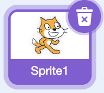
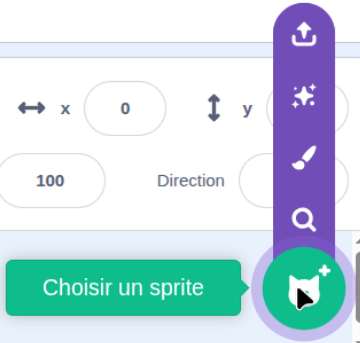
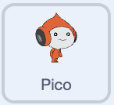
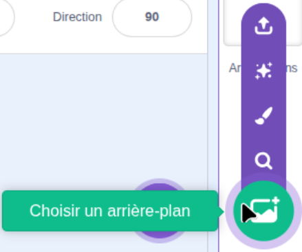
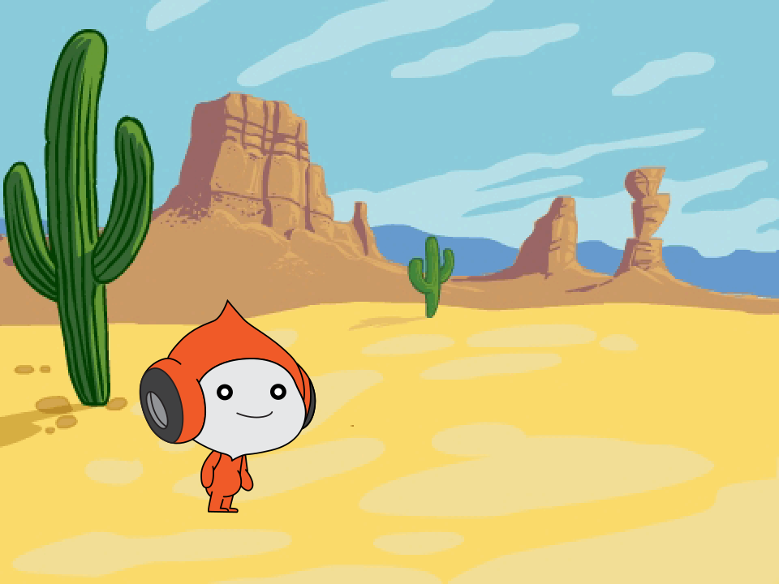

## Ajouter le personnage et l'arrière-plan

Ajoute ton personnage et choisis le lieu où se déroulera ton jeu de saut.

> [!TASK]
>
> Ouvre un [nouveau projet Scratch](https://scratch.mit.edu/projects/editor/){:target="_blank"} dans un nouvel onglet. Le projet qui s'ouvre avec le chat Scratch est le bon point de départ.

> [!TASK]
>
> Supprime le sprite du chat pour commencer avec une scène vide.
>
> 

> [!TASK]
>
> Clique sur **Choisir un sprite**.
>
> 
>
> Trouve `Pico`{:class="block3looks"} dans la bibliothèque de sprites et clique dessus.
>
> 
>
> Pico apparaît sur la scène.

> [!TASK]
>
> Clique sur **Choisir un arrière-plan**.
>
> 
>
> Trouve `Desert`{:class="block3looks"} dans la bibliothèque d'arrière-plan et clique dessus.
>
> Ta scène montre maintenant Pico dans le désert.
>
> 
>
> Pico pourrait être dans un autre endroit sur ta scène. Tu vas définir sa position de départ suivante.

> [!TASK]
>
> Clique sur le sprite `Pico`{:class="block3looks"}, puis clique sur l'onglet **Code**.
>
> Ajoute un script pour placer Pico près du bas à gauche de la scène.
>
> {:width="100px" height="100px" style="object-fit: contain;"}
>
> ```blocks3
> +when green flag clicked
> +go to x: (-100) y: (-70)
> ```

> [!TASK]
>
> **Teste ton projet.** Clique sur le drapeau vert, fais glisser Pico vers un autre endroit sur la scène, puis clique à nouveau sur le drapeau vert.
>
> Pico retourne à sa position de départ.
