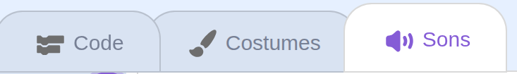
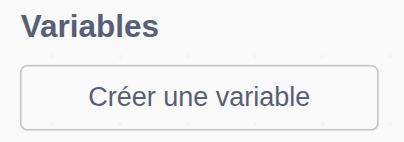
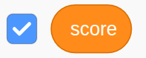

## Détecter les collisions et garder le score

La partie s'arrête lorsqu'un obstacle touche Pico. Gagne un point chaque fois qu’un obstacle passe devant Pico sans le toucher.

> [!TASK]
>
> Dans la boucle de mouvement du clone, ajoute un bloc `si alors`{:class="block3control"} qui vérifie si l'obstacle touche ()`{:class="block3sensing"} Pico.
>
> Si c'est le cas, arrête tous les scripts.
>
> {:width="100px" height="100px" style="object-fit: contain;"}
>
> ```blocks3
> repeat until <(x position) < (-240)>
>   next costume
>   change x by (-5)
> +  if <touching (Pico v)?> then
>     stop [tout v]
>   end
> end
> ```

> [!TASK]
>
> Clique sur le sprite `Dinosaur5`{:class="block3looks"}, puis ouvre l'onglet `Sons`{:class="block3sound"}.
>
> `Dinosaur5` inclut déjà le son `bite`{:class="block3sound"}. Tu peux l'utiliser ou choisir un autre son de collision.
>
> 

> [!TASK]
>
> Ajoute un bloc `jouer le son () jusqu'au bout`{:class="block3sound"} à l'intérieur de la vérification de collision, avant `stop tout`{:class="block3control"}.
>
> {:width="100px" height="100px" style="object-fit: contain;"}
>
> ```blocks3
> if <touching (Pico v)?> then
> +  play sound (bite v) until done
>   stop [all v]
> end
> ```

> [!TASK]
>
> Crée une nouvelle variable appelée `score`{:class="block3variables"}, **Pour tous les sprites**.
>
> 
>
> Laisse la case cochée pour que la variable apparaisse sur la scène.
>
> 

> [!TASK]
>
> Dans le script de configuration de l'obstacle, définis `score`{:class="block3variables"} sur `0` quand le drapeau vert est cliqué.
>
> {:width="100px" height="100px" style="object-fit: contain;"}
>
> ```blocks3
> when green flag clicked
> +set [score v] to (0)
> set size to (25) %
> go to x: (280) y: (-85)
> hide
> forever
>   create clone of (moi-même v)
>   wait (pick random (0.8) to (2.4)) seconds
> end
> ```

> [!TASK]
>
> Dans le script de clonage, ajoute `ajouter () à score`{:class="block3variables"} après la boucle de mouvement et avant `supprimer ce clone`{:class="block3control"}.
>
> {:width="100px" height="100px" style="object-fit: contain;"}
>
> ```blocks3
> when I start as a clone
> show
> repeat until <(x position) < (-240)>
>   next costume
>   change x by (-5)
>   if <touching (Pico v)?> then
>     play sound (bite v) until done
>     stop [tout v]
>   end
> end
> +change [score v] by (1)
> delete this clone
> ```
>
> Le nouveau bloc ne s'exécute que lorsqu'un obstacle atteint le bord gauche sans toucher Pico.

> [!TASK]
>
> **Teste ton projet.** Éviter un obstacle devrait ajouter `1` à `score`{:class="block3variables"}. Si un obstacle touche Pico, joue le son de collision et arrête le jeu.
