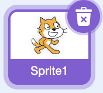
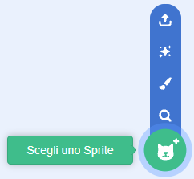
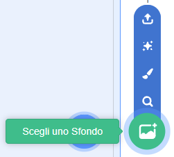
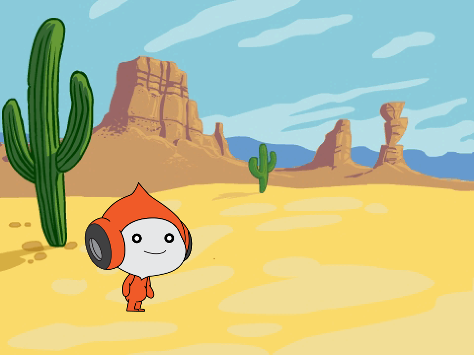

## Aggiungi il personaggio e lo sfondo

Aggiungi il tuo personaggio e scegli dove si svolgerà il tuo gioco con salti.

> [!TASK]
>
> Apri un [nuovo progetto Scratch](https://scratch.mit.edu/projects/editor/){:target="_blank"} in una nuova scheda. Il progetto che si apre con il gatto Scratch è il punto di partenza giusto.

> [!TASK]
>
> Elimina lo sprite del gatto, in modo da iniziare con uno Stage vuoto.
>
> 

> [!TASK]
>
> Clicca su **Scegli uno Sprite**.
>
> 
>
> Trova `Pico`{:class="block3looks"} nella libreria degli sprite e fai clic su di esso.
>
> 
>
> Pico apparirà sullo stage.

> [!TASK]
>
> Fai clic su **Scegli uno sfondo**.
>
> 
>
> Trova `Desert`{:class="block3looks"} nella libreria degli sfondi e fai clic su di esso.
>
> Il tuo Stage ora mostra Pico nel deserto.
>
> 
>
> Pico potrebbe essere in un posto diverso sul tuo Stage. Quindi imposterai la sua posizione di partenza.

> [!TASK]
>
> Fai clic sullo sprite `Pico`{:class="block3looks"}, quindi fai clic sulla scheda **Codice**.
>
> Aggiungi uno script per posizionare Pico vicino alla parte inferiore sinistra dello Stage.
>
> {:width="100px" height="100px" style="object-fit: contain;"}
>
> ```blocks3
> +when green flag clicked
> +go to x: (-100) y: (-70)
> ```

> [!TASK]
>
> **Prova il tuo progetto.** Fai clic sulla bandiera verde, trascina Pico in un altro posto sullo Stage, quindi fai nuovamente clic sulla bandiera verde.
>
> Pico torna alla sua posizione di partenza.
