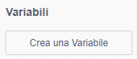
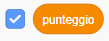

## Rileva le collisioni e tieni il punteggio

Termina il gioco quando un ostacolo tocca Pico e assegna un punto ogni volta che un ostacolo supera Pico senza causare danni.

> [!TASK]
>
> All'interno del ciclo di movimento del clone, aggiungi un blocco `se allora`{:class="block3control"} che controlla se l'ostacolo `sta toccando ()`{:class="block3sensing"} Pico.
>
> Se accade, interrompi tutti gli script.
>
> {:width="100px" height="100px" style="object-fit: contain;"}
>
> ```blocks3
> repeat until <(x position) < (-240)>
>   next costume
>   change x by (-5)
> +  if <touching (Pico v)?> then
>     stop [all v]
>   end
> end
> ```

> [!TASK]
>
> Fai clic sullo sprite `Dinosaur5`{:class="block3looks"}, quindi apri la scheda `Suoni`{:class="block3sound"}.
>
> `Dinosaur5` include già il suono `bite`{:class="block3sound"}. Puoi usarlo, oppure scegliere un suono diverso per la collisione.
>
> 

> [!TASK]
>
> Aggiungi un blocco `riproduci suono () e attendi la fine`{:class="block3sound"} all'interno del controllo delle collisioni, prima di `ferma tutto`{:class="block3control"}.
>
> {:width="100px" height="100px" style="object-fit: contain;"}
>
> ```blocks3
> if <touching (Pico v)?> then
> +  play sound (bite v) until done
>   stop [all v]
> end
> ```

> [!TASK]
>
> Aggiungi una nuova variabile chiamata `punteggio`{:class="block3variables"} per **tutti gli sprite**.
>
> 
>
> Mantieni la casella di controllo selezionata, in modo che la variabile appaia nello Stage.
>
> 

> [!TASK]
>
> Nei blocchi dell'ostacolo, imposta `punteggio`{:class="block3variables"} a `0` quando si fa clic sulla bandierina verde.
>
> {:width="100px" height="100px" style="object-fit: contain;"}
>
> ```blocks3
> when green flag clicked
> +set [score v] to (0)
> set size to (25) %
> go to x: (280) y: (-85)
> hide
> forever
>   create clone of (myself v)
>   wait (pick random (0.8) to (2.4)) seconds
> end
> ```

> [!TASK]
>
> Nei blocchi di clonazione, aggiungi `cambia punteggio di ()`{:class="block3variables"} dopo il ciclo di movimento e prima di `elimina questo clone`{:class="block3control"}.
>
> {:width="100px" height="100px" style="object-fit: contain;"}
>
> ```blocks3
> when I start as a clone
> show
> repeat until <(x position) < (-240)>
>   next costume
>   change x by (-5)
>   if <touching (Pico v)?> then
>     play sound (bite v) until done
>     stop [all v]
>   end
> end
> +change [score v] by (1)
> delete this clone
> ```
>
> Il nuovo blocco viene eseguito solo dopo che un ostacolo ha raggiunto il bordo sinistro senza toccare Pico.

> [!TASK]
>
> **Prova il tuo progetto.** Evitare un ostacolo dovrebbe aggiungere `1` allo `score`{:class="block3variables"}. Toccandone uno, dovrebbe essere riprodotto il suono di collisione e il gioco dovrebbe interrompersi.
