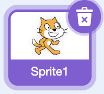
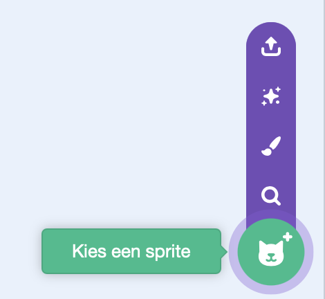
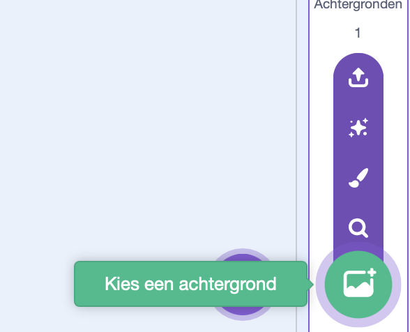
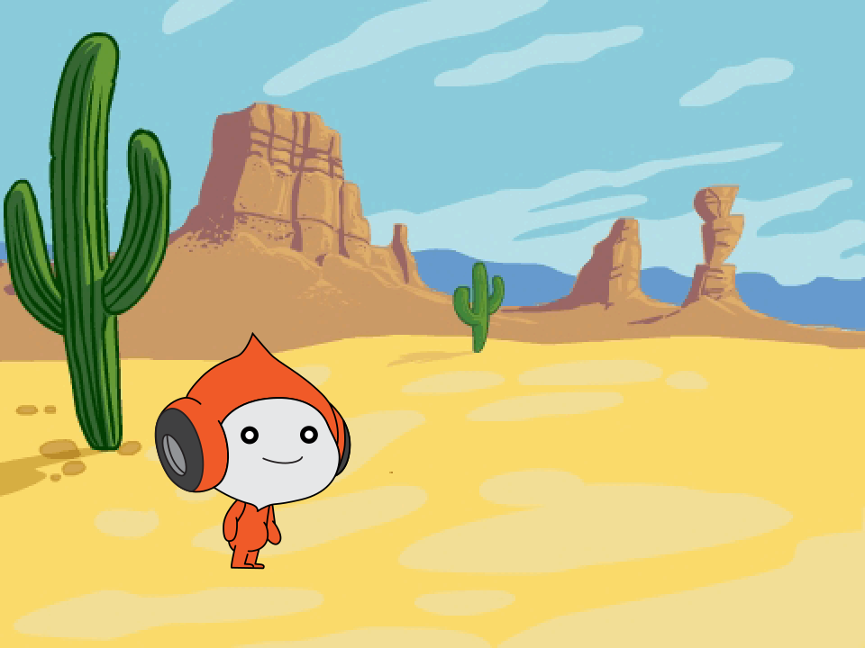

## Voeg het personage en de achtergrond toe

Voeg je personage toe en kies waar je springspel zich zal afspelen.

> [!TASK]
>
> Open een [nieuw Scratch-project](https://scratch.mit.edu/projects/editor/){:target="_blank"} in een nieuw tabblad. Het project dat begint met de Scratch-kat is een goed uitgangspunt.

> [!TASK]
>
> Verwijder de kat sprite, zodat je begint met een leeg speelveld.
>
> 

> [!TASK]
>
> Klik op **Kies een sprite**.
>
> 
>
> Zoek `Pico`{:class="block3looks"} in de sprite bibliotheek en klik erop.
>
> 
>
> Pico verschijnt op het speelveld.

> [!TASK]
>
> Klik op **Kies een achtergrond**.
>
> 
>
> Zoek `Desert`{:class="block3looks"} in de achtergrond bibliotheek en klik erop.
>
> Op je speelveld zie je Pico in de woestijn (desert).
>
> 
>
> Pico staat misschien op een andere plek op jouw speelveld. Je gaat de beginpositie hierna instellen.

> [!TASK]
>
> Klik op de sprite `Pico`{:class="block3looks"} en klik vervolgens op het tabblad **Code**.
>
> Voeg een script toe om Pico linksonder op het speelveld te plaatsen.
>
> {:width="100px" height="100px" style="object-fit: contain;"}
>
> ```blocks3
> +when green flag clicked
> +go to x: (-100) y: (-70)
> ```

> [!TASK]
>
> **Test je project.** Klik op de groene vlag, sleep Pico naar een andere plek op het speelveld en klik vervolgens nogmaals op de groene vlag.
>
> Pico gaat terug naar zijn beginpositie.
