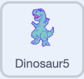

## Voeg obstakels toe

Maak iets waar Pico overheen kan springen.

> [!TASK]
>
> Klik op **Kies een sprite**, zoek vervolgens `Dinosaur5`{:class="block3looks"} in de sprite bibliotheek en klik erop.
>
> 
>
> Dinosaur5 heeft verschillende uiterlijken, dus je kan hem laten bewegen met animatie.

> [!TASK]
>
> Klik op de sprite `Dinosaur5`{:class="block3looks"} en klik vervolgens op het tabblad **Code**.
>
> Voeg een script toe om de grootte en positie in te stellen.
>
> {:width="100px" height="100px" style="object-fit: contain;"}
>
> ```blocks3
> +when green flag clicked
> +set size to (25) %
> +go to x: (280) y: (-85)
> ```

> [!TASK]
>
> **Test je project.** Klik op de groene vlag.
>
> Het obstakel verkleint en gaat naar de rechterkant van het speelveld, en is klaar naar Pico te bewegen.
