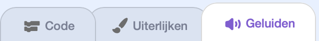
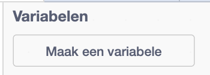

## Detecteer botsingen en houd de score bij

Beëindig het spel wanneer Pico op een obstakel botst en geef een punt wanneer Pico een obstakel ontwijkt.

> [!TASK]
>
> Voeg binnen de bewegingslus van de kloon een `als dan`{:class="block3control"}-blok toe dat controleert of het obstakel Pico `raakt ()`{:class="block3sensing"}.
>
> Als dat het geval is, stop dan alle scripts.
>
> {:width="100px" height="100px" style="object-fit: contain;"}
>
> ```blocks3
> repeat until <(x position) < (-240)>
>   next costume
>   change x by (-5)
> +  if <touching (Pico v)?> then
>     stop [alle v]
>   end
> end
> ```

> [!TASK]
>
> Klik op de sprite `Dinosaur5`{:class="block3looks"} en open vervolgens het tabblad `Geluiden`{:class="block3sound"}.
>
> `Dinosaur5` bevat al het `bite`{:class="block3sound"} geluid. Je kunt het gebruiken, of een ander botsingsgeluid kiezen.
>
> 

> [!TASK]
>
> Voeg een `start geluid () en wacht`{:class="block3sound"} blok toe binnen de botsingscontrole, vóór `stop alle`{:class="block3control"}.
>
> {:width="100px" height="100px" style="object-fit: contain;"}
>
> ```blocks3
> if <touching (Pico v)?> then
> +  play sound (bite v) until done
>   stop [alle v]
> end
> ```

> [!TASK]
>
> Maak een nieuwe variabele met de naam `score`{:class="block3variables"}, **Voor alle sprites**.
>
> 
>
> Houd het selectievakje aangevinkt zodat de variabele verschijnt in het speelveld.
>
> 

> [!TASK]
>
> Stel in het setup-script van het obstakel de variabele `score`{:class="block3variables"} in op `0` wanneer op de groene vlag wordt geklikt.
>
> {:width="100px" height="100px" style="object-fit: contain;"}
>
> ```blocks3
> when green flag clicked
> +set [score v] to (0)
> set size to (25) %
> go to x: (280) y: (-85)
> hide
> forever
>   create clone of (mijzelf v)
>   wait (pick random (0.8) to (2.4)) seconds
> end
> ```

> [!TASK]
>
> Voeg in het kloon-script `verander score met ()`{:class="block3variables"} toe na de bewegingslus en voor `verwijder deze kloon`{:class="block3control"}.
>
> {:width="100px" height="100px" style="object-fit: contain;"}
>
> ```blocks3
> when I start as a clone
> show
> repeat until <(x position) < (-240)>
>   next costume
>   change x by (-5)
>   if <touching (Pico v)?> then
>     play sound (bite v) until done
>     stop [alle v]
>   end
> end
> +change [score v] by (1)
> delete this clone
> ```
>
> Het nieuwe blok wordt pas geactiveerd nadat een obstakel de linkerrand bereikt zonder Pico aan te raken.

> [!TASK]
>
> **Test je project.** Het vermijden van een obstakel zou '1' moeten toevoegen aan de score. Als je er een aanraakt, wordt het botsingsgeluid afgespeeld en stopt het spel.
